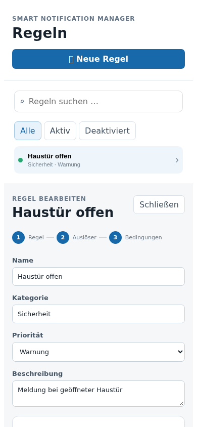

# Smart Notification Manager

Zentrale, nachvollziehbare Benachrichtigungsverwaltung als Home-Assistant-Custom-Integration mit deutscher Primärdokumentation.

> **Entwicklungsstatus:** Phase 2 von 12 abgeschlossen und in `main` integriert. Noch nicht installierbar, kein Versand, keine Telefonie, kein HACS-Release.

## Ziel

Der Smart Notification Manager soll Regeln, Alarmlebenszyklen, Empfänger, Kanäle, Eskalationen, Ruhezeiten, Simulation, Historie und eine responsive Oberfläche zentral verwalten. Die fachliche Zielplanung ist in [docs/REQUIREMENTS.md](docs/REQUIREMENTS.md) erfasst; unbestätigte Anforderungen sind ausdrücklich markiert.

## Phase-1-Inhalt

- Domain `smart_notification_manager` und Config-/Options-Flow
- Home-Assistant-unabhängige Kernmodelle und Schnittstellen
- Versionierte SQLite-Schema-Migration mit Foreign Keys, Indizes und eindeutiger aktiver Alarmursache
- Async-sicherer Repository-Rahmen über `asyncio.to_thread`
- Adapter-, Router-, Rechte-, Bedingungs- und Lifecycle-Verträge
- Offline-Tests ohne produktive Home-Assistant-Installation; Phase-1-Abnahme mit 17 Tests und grüner GitHub-CI

Die Datenbank wird nicht automatisch in einer produktiven HA-Instanz angelegt. Das Phase-2-Panel verwaltet nur integrationsinterne Regeldefinitionen; ein Versand-Service existiert noch nicht.

## Dokumentation

- [Architektur](docs/ARCHITECTURE.md)
- [Datenmodell](docs/DATA_MODEL.md)
- [API-Verträge](docs/API_CONTRACTS.md)
- [Anforderungen](docs/REQUIREMENTS.md)
- [Entwicklungsplan](docs/DEVELOPMENT_PLAN.md)
- [Testplan](docs/TEST_PLAN.md)
- [Release-Policy](docs/RELEASE_POLICY.md)

## Phase-2-Ergebnis

Der visuelle Regeleditor unterstützt Regelübersicht, Suche, Prioritäten,
Entitätsauswahl aus HA-Registern, Zustandsauslöser, verschachtelte
Bedingungsgruppen, verständliche Vorschau und responsive Darstellung.




Die Screenshots stammen aus dem isolierten Browser-Fixture und zeigen keine
produktive Home-Assistant-Instanz.

## Entwicklung

```bash
uv sync --extra test
uv run pytest
uv run ruff check .
python -m compileall custom_components
```

Für die Entwicklungsstände existieren noch keine öffentlichen Installationsanweisungen. Es werden keine GitHub-Releases, Tags oder öffentlichen HACS-Einträge erzeugt. Vor `v1.0.0-beta.1` müssen die offenen Qualitäts-Gates aus den verknüpften GitHub-Issues abgeschlossen sein.

## Beiträge und Fehler

Beiträge und Fehlerberichte werden über GitHub Issues und Pull Requests angenommen. Bitte keine Zugangsdaten, privaten Nachrichteninhalte oder Standortdaten in Issues einfügen.

## Lizenz

Die Lizenzentscheidung ist weiterhin offen und wird vor einer öffentlichen Veröffentlichung dokumentiert.

## English summary

Smart Notification Manager is a German-first Home Assistant custom integration under development. Phase 2 is complete on `main` and adds an authenticated admin panel, recursive visual rule editing, versioned SQLite persistence and isolated browser/API tests. Delivery, telephony and HACS publication are not available yet.
